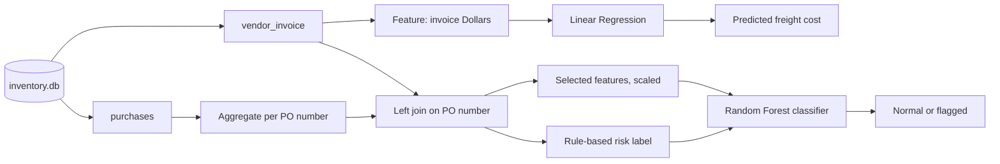

# 🚚 Freight Cost Prediction & Invoice Flagging

Two machine learning pipelines built on a SQLite purchasing database (`inventory.db`) from a beverage retailer:

1. **Freight cost prediction** (regression): estimate the freight charge on a vendor invoice from its dollar value, to support cost forecasting, budgeting and vendor negotiation.
2. **Invoice flagging** (classification): flag vendor invoices that look risky, so they can be reviewed before payment.


**Contents:** [Data](#-data) · [How it works](#-how-it-works) · [What I found](#-what-i-found) · [Structure](#-project-structure) · [Roadmap](#-roadmap)

---

## 🗄️ Data

The database holds several tables (`purchases`, `purchase_prices`, `vendor_invoice`, `begin_inventory`, `end_inventory`). These two pipelines use:

| Table | Used for | Key columns |
|---|---|---|
| `vendor_invoice` | Both pipelines | `PONumber`, `Quantity`, `Dollars`, `Freight`, `PODate`, `InvoiceDate`, `PayDate` |
| `purchases` | Invoice flagging (aggregated per purchase order) | `PONumber`, `Brand`, `Quantity`, `Dollars`, `PODate`, `ReceivingDate` |

- **Source:** `[TODO: dataset name and link]`
- Column names are capitalised in the database, so queries must match the exact casing.

---

## ⚙️ How it works



### 1. Freight prediction
- **Target:** `Freight`. **Feature:** invoice `Dollars`.
- Compared Linear Regression, Decision Tree and Random Forest on a held-out test set.
- A single input feature means no scaling is needed.

### 2. Invoice flagging
- **Per-PO features** built from `purchases`: number of distinct brands, total item quantity, total item dollars, average receiving delay.
- **Invoice features:** quantity, dollars, freight, days from PO to invoice, days from invoice to payment. Joined to the per-PO features with a left join.
- **Label (`flag_invoice`)** is rule-based. An invoice is flagged when its dollar total does not match the sum of its purchase line items, or when the average receiving delay is unusually long.
- A `StandardScaler` is fitted on the training data only and then applied to the test data.
- Compared Logistic Regression, Decision Tree and Random Forest, then narrowed the inputs using Random Forest feature importances.

---

## 💡 What I found

- **Freight grows almost linearly with invoice size**, so a plain Linear Regression on `Dollars` beat both tree models. A simple model was the right call.
- **For invoice flagging, Random Forest performed best** and Logistic Regression was clearly the weakest.
- **Accuracy alone is misleading** when flagged invoices are the minority class. Logistic Regression looked acceptable on accuracy but missed almost every flagged invoice, so I judged models on precision, recall and F1 for the flagged class.
- **Grid search did not help.** Limiting tree depth raised precision but cost too much recall, so I kept the unrestricted forest.
- **Invoice and line-item dollar totals mattered most** in the Random Forest feature importances, followed by item quantity and freight.

---

## 📁 Project structure

```
.
├── freight_prediction/   # regression pipeline
├── invoice_flagging/     # classification pipeline
├── models/               # saved trained models
├── notebooks/            # predicting_freight_cost.ipynb, invoice_flagging.ipynb
├── requirements.txt
└── README.md
```
---

## 👤 Author

**Yadav Chandan** · [GitHub](https://github.com/yadavchandan26)

Feedback and suggestions are welcome.
